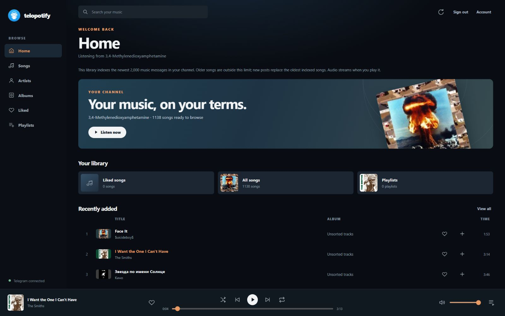
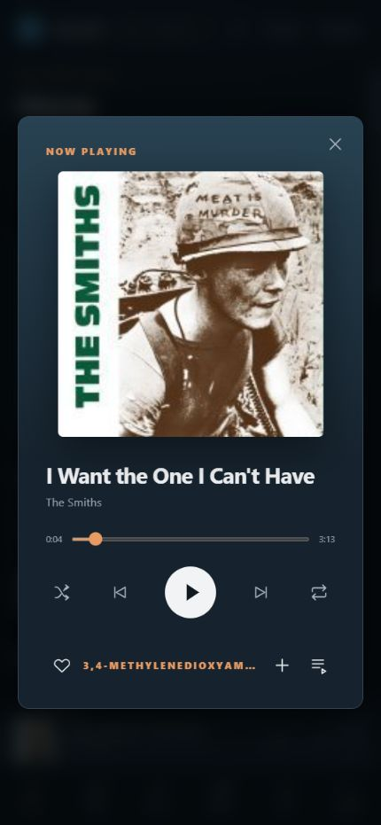
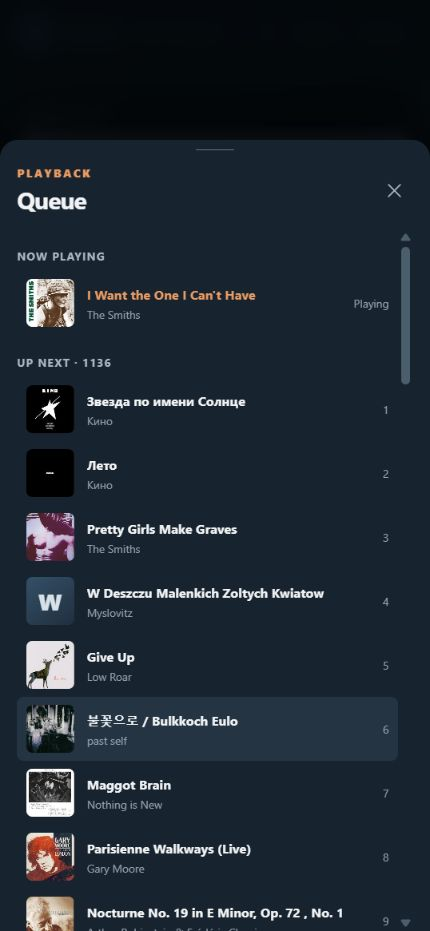
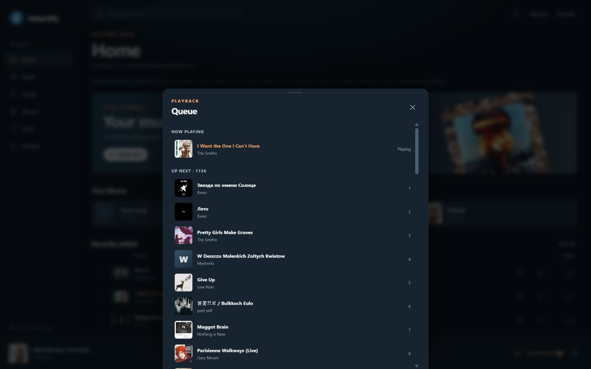
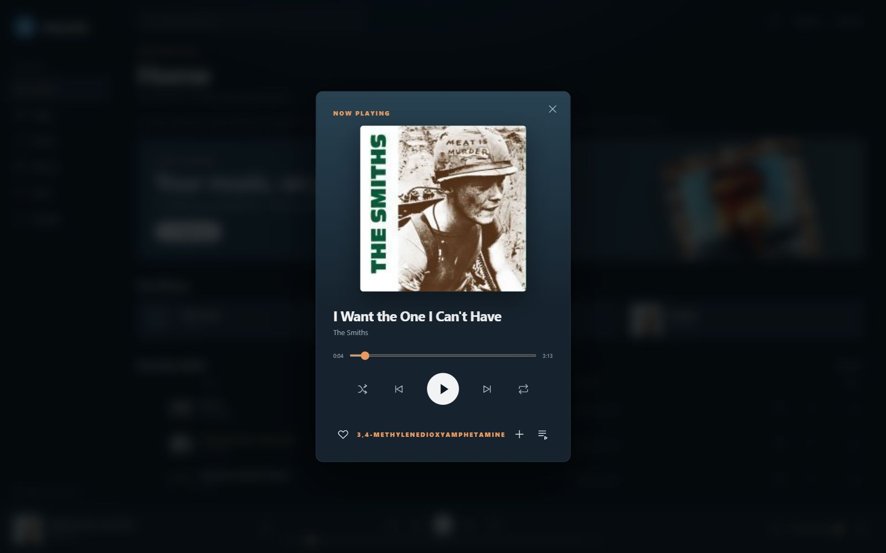

# Telopotify

<p align="center"></p>

**Your Telegram music channel, in a music player.** Telopotify indexes song metadata from a channel you can access and streams audio when you press play. Opening a library does not download every song.

The project includes a React Native Windows player, a native iPhone player, and a responsive web player. Windows and web use a Node.js Telegram service. The iPhone player connects to Telegram itself through TDLib and needs no desktop bridge.

> **Hosted app status: invite-only development beta.** Registration is closed by default. Use it with a small trusted group, HTTPS, and a correctly configured hosting proxy. Telegram API credentials are required configuration; no test credentials are embedded.

Source code is available under the [MIT license](LICENSE). Repository visibility does not expose local Telegram sessions or account data; keep `local-data/`, signing files, and environment secrets out of Git. Publishing the source does **not** make the hosted web-account service ready for unrestricted public use.

## Choose what to run

| Experience | Start here | Telegram connection |
| --- | --- | --- |
| Windows app | `npm run app:windows` | Local bridge on the PC |
| Web player, one library | `npm run dev:library` | Same local bridge and collection as Windows |
| Shared remote web player | `npm run dev:library` and `npm run web:gateway` | One library behind a sharing password |
| Separate web accounts | `npm run web:accounts` | Each person signs in to their own Telegram account |
| Native iPhone app | [Build and install the IPA](#iphone-build-and-install) | TDLib on the iPhone; no PC or VPS required |

Commands run from the **repository root** unless a section says to enter `TelopotifyApp/`. Browser-only use needs just the root Node dependencies. Native development also needs the React Native dependencies.

## What is implemented

- **Library:** Telegram login, channel selection, saved catalog, incremental new-post sync, search, recently added/played, artists, albums, liked songs, and playlists. The Windows/web bridge indexes up to 2,000 music messages per channel without downloading their audio.
- **Playback:** On-demand byte-range streaming, seek, play/pause, queue, next/previous, shuffle, repeat, artwork, and a persistent Now Playing area. Windows also has native media controls, speed, sleep timer, and next-track preparation.
- **Storage:** Encrypted/saved Telegram sessions, local collections, a bounded RAM stream cache, and optional selected-song offline downloads in the Windows app. The full channel is never downloaded automatically.
- **Web accounts:** Password changes require the current password. One-time recovery codes replace email recovery; recovery signs out all existing web sessions while preserving Telegram sessions, libraries, and playlists.
- **iPhone:** Native TDLib access, paged song loading, saved catalog and channel choice, local likes/playlists, and native background-audio and lock-screen integration.

The interfaces are **not fully feature-identical**. The iPhone app is independent of the Windows/web bridge, and local collections do not automatically sync between them. Long-session iPhone background playback and network interruption handling still need broader real-device testing.

| Capability | Windows | Web | Native iPhone |
| --- | --- | --- | --- |
| Telegram connection | Local Node bridge | Hosted Node bridge per web account, or shared local bridge | TDLib directly on device |
| Catalog | Newest 2,000 music messages | Newest 2,000 music messages | Pages through channel history; no shared 2,000-message cap |
| Playback | Native Windows media player and system controls | Browser audio; background behavior depends on the browser/OS | Native AVPlayer, background audio and lock-screen controls |
| Extra controls | Speed, sleep timer, selected-song offline downloads | Queue, shuffle, repeat; no offline-download UI | Native queue, shuffle and repeat; TDLib cache |
| Artwork/albums | Telegram covers, external fallback, local album overrides | Telegram covers and external fallback; local album overrides | Telegram thumbnails and `Album:` captions |
| Accounts/collections | Local Windows data | Web-password/recovery system only in `web:accounts`; per-user server data | On-device Telegram session and collections; no web-password system |

The Android directory is an unvalidated scaffold, not a supported release. The browser version cannot promise uninterrupted iPhone background playback; use the native iPhone build for that path.

## Screenshots

Actual screens from the running responsive **web app**, captured at 1600 × 1000 on desktop and 430 pixels wide on mobile. The mobile views below are browser UI, not screenshots of the native iPhone build.



| Mobile Now Playing | Mobile queue drawer |
| --- | --- |
|  |  |

<details>
<summary>Desktop queue and Now Playing</summary>





</details>

## Install

Install [Git](https://git-scm.com/) and **Node.js 24** (recommended; the React Native package requires at least 22.11). Then:

```sh
git clone https://github.com/behrad00rad/telopotify.git
cd telopotify
npm ci
```

For **Windows or native mobile development**, also install:

```sh
cd TelopotifyApp
npm ci
cd ..
```

The web server does **not** require Visual Studio, Xcode, Android Studio, or `TelopotifyApp/node_modules`. It does use the checked-in logo from `TelopotifyApp/assets/`.

Before starting any Telegram service, configure your [Telegram API ID and hash](#telegram-api-credentials) in the same terminal or hosting environment. Services now fail early with a configuration message if these are missing.

### Windows build tools

The native Windows build requires Visual Studio with C++/Windows app tools, the Windows SDK, **PowerShell 7** (`pwsh.exe`), and trusted-app deployment enabled. The launcher targets Windows SDK `10.0.26100.0`; install that SDK or adjust [the launcher](scripts/run-windows.ps1) to your version. This checkout was built with Visual Studio 2026 and that SDK.

## Run the Windows app

From PowerShell in the repository root:

```powershell
npm run app:windows
```

The launcher starts the Telegram bridge and Metro if needed, then builds and opens the app. It reuses running services on later launches. The app discovers its bridge automatically. Sign in to Telegram in the app, choose a channel, and let the first metadata index finish. Keep the bridge and Metro running while using this development build.

To see service errors separately, use two terminals, then retry `npm run app:windows`:

```powershell
# Terminal 1: repository root
npm run dev:library

# Terminal 2: TelopotifyApp directory
cd TelopotifyApp
npm start
```

The bridge is loopback-only at `127.0.0.1:43127`. **Never expose that port publicly.**

## Run the web player

### One local library

```sh
npm run dev:library
```

Open **<http://127.0.0.1:43127/web>** on the same PC. This uses the same Telegram session, channel, likes, and playlists as Windows. The responsive browser player has Home, Songs, Artists, Albums, Liked, Playlists, search, a full Now Playing view, and a bottom queue drawer.

### Share one library with other devices

Keep `npm run dev:library` running. In a second terminal, set a strong password and run the gateway:

```powershell
$env:TELOPOTIFY_WEB_PASSWORD = 'replace-with-a-long-unique-password'
npm run web:gateway
```

On Linux/macOS, use `export TELOPOTIFY_WEB_PASSWORD='...'` before the gateway command. It listens at `127.0.0.1:43128`. Publish **43128**, not 43127, through an HTTPS tunnel or reverse proxy; open the public URL with `/web` appended. Everyone with the password shares one Telegram account and library. Closing the PC or service stops streaming.

### Give each person a separate web account

```sh
npm run web:accounts
```

Open **<http://127.0.0.1:43129/web>** locally. Each person signs in to a Telopotify web account, connects their own Telegram account, and chooses a channel. Their Telegram session, catalog, artwork cache, likes, and playlists are kept separately under ignored `local-data/web-accounts/`.

New account registration is **closed by default**. To create accounts, start the server with `TELOPOTIFY_ALLOW_SIGNUPS=1`, create the accounts, then restart it without that setting. On PowerShell, run `$env:TELOPOTIFY_ALLOW_SIGNUPS = '1'` before `npm run web:accounts`; run `Remove-Item Env:TELOPOTIFY_ALLOW_SIGNUPS` before restarting to close registration. Only leave registration open on a trusted, access-controlled service. Existing users can sign in while registration is closed.

**Phone and other-device access:** give this server its own HTTPS address (for example, `https://music.example.com`) and forward that address to `http://127.0.0.1:43129` on the same host. Open `https://music.example.com/web` on each device. Forward the entire site, including `/web`, `/auth`, `/audio`, and `/artwork`; the browser uses same-origin requests. A Cloudflare Tunnel public hostname can point to `http://localhost:43129`, or an HTTPS reverse proxy can pass the original `Host` header. This uses a separate hostname and does not require changing an existing website. **Do not publish the Telegram bridge on port 43127.** A direct `http://<LAN-IP>:43129` URL cannot sign in: web-account cookies require HTTPS.

The account server binds to `127.0.0.1:43129` by default. For a container or hosting platform that needs a public interface, set `TELOPOTIFY_WEB_HOST=0.0.0.0`; set `TELOPOTIFY_WEB_PORT` or the platform's `PORT` to choose the listener port. Put HTTPS in front of it and limit direct access to the HTTP port.

On a Linux VPS, generate a **stable** 32-byte base64 key once and save it as `TELOPOTIFY_SESSION_KEY` in your host's secret manager or a protected environment file:

```sh
openssl rand -base64 32
# Save the generated value securely, then supply it to this shell:
export TELOPOTIFY_SESSION_KEY='your-saved-base64-key'
npm run web:accounts
```

On Windows, the server creates an ignored `local-data/web-accounts/session.key` when the environment variable is absent. Preserve that file. Changing or losing the key makes saved Telegram sessions unreadable. Back up `local-data/web-accounts/` securely; Git ignores it. Web-account passwords are salted scrypt hashes. Web login cookies expire after seven days and clear on server restart, but saved Telegram sessions remain.

### Web password and recovery

- **Account → Change password** requires the current web password. Other web sessions are signed out; the requesting browser gets a new session. Your Telegram password is unaffected.
- On registration, save the generated recovery code in a password manager. It is shown once and requires a save acknowledgement. The server stores only a SHA-256 hash of the 192-bit random code.
- Existing users can choose **Account → Generate replacement code**, confirming their current password. This immediately replaces the old code. Account settings also remain accessible during Telegram setup or a music-service connection failure.
- **Forgot password?** takes your username, saved recovery code, and a new web password. Each code works once. Save the replacement code shown after recovery, then sign in. All old web sessions are invalidated; your account ID, Telegram session, library and playlists are preserved.
- There is no email recovery. If you lose both your password and recovery code, self-service recovery is unavailable. Reloading a code screen before saving it loses that display; a signed-in user can generate another after password confirmation.

### Hosting proxy and process limits

| Variable | Default | Purpose |
| --- | --- | --- |
| `TELOPOTIFY_TRUSTED_PROXIES` | Empty | Comma-separated **exact IP addresses** of your trusted proxy hops; no wildcards or CIDR ranges |
| `TELOPOTIFY_MAX_BRIDGES` | `8` | Maximum per-user Telegram processes, including processes still starting |
| `TELOPOTIFY_BRIDGE_IDLE_MINUTES` | `15` | Stop a bridge after this many idle minutes; checked every minute |

Forwarded client IPs are ignored unless the immediate peer is explicitly trusted. For a local Nginx proxy or Cloudflare Tunnel connector, set `TELOPOTIFY_TRUSTED_PROXIES=127.0.0.1,::1` **only if that proxy supplies a trustworthy `X-Forwarded-For` chain**. Walks through the chain stop at the first untrusted hop. Your proxy must overwrite or correctly append client IPs, preserve the original `Host`, and block direct public access to the Node port. Do not trust arbitrary internet peers or blindly accept `CF-Connecting-IP`; the app reads only `X-Forwarded-For` from configured proxies. This keeps unrelated remote clients from sharing the proxy's login/recovery lockout and prevents direct clients from choosing their own IP. Attempts are also limited per username; `429` responses include `Retry-After`.

Ongoing requests and audio streams hold a bridge slot until they finish or disconnect. Idle cleanup preserves saved data and never evicts a bridge with an active request. A closed bridge restarts on the next request. If all slots are occupied, new users receive a retryable `503` instead of interrupting another user's playback. An open browser polls the service, so a tab still being used keeps its bridge alive. These controls assume one Node account-server instance using the data directory; do not run multiple instances against the same account files.

For internet hosting, run Node with a process manager so it restarts after a crash or reboot, use persistent storage, and route a dedicated HTTPS hostname to port 43129. A separate host/domain can keep Telopotify apart from an existing website. This is still development software intended for a trusted group; registration must be explicitly enabled, and a fully public service needs further operational security review.

### GitHub Codespaces: web-only test

Create a Codespace from this repository, run `npm ci`, add a persistent Codespaces secret called `TELOPOTIFY_SESSION_KEY`, then run `npm run web:accounts`. Forward port **43129** and append `/web` to the HTTPS forwarding URL. A private port requires GitHub login; a public port exposes the login page to anyone with the URL. Enable registration only when needed. Codespaces stops after inactivity and is a test environment, not 24/7 hosting. Ignored account data disappears if the Codespace is deleted.

## Optional Cloudflare Worker relay

Use this **only with `web:accounts`** when the server can reach Cloudflare over WSS but cannot reach Telegram directly. The Node server starts a loopback SOCKS5 adapter; the Worker relays Telegram protocol bytes to Telegram DC IPv4 addresses on port 443. The browser never receives the relay token. The Worker is neither a general-purpose proxy nor a host for the web app.

Deploy from a machine that can access Cloudflare, in the repository root:

```sh
npx wrangler login
npx wrangler deploy web/telegram-relay-worker.mjs --name telopotify-telegram-relay --compatibility-date 2026-09-29
npx wrangler secret put RELAY_TOKEN --name telopotify-telegram-relay
```

Generate a token with `node -e "console.log(require('node:crypto').randomBytes(32).toString('base64url'))"`. Enter it at Wrangler's secret prompt. Supply the **same** value as `TELOPOTIFY_RELAY_TOKEN` on the web server, plus the Worker's `wss://...workers.dev` URL:

```sh
# Linux shell example; use your own saved secrets and URL.
export TELOPOTIFY_RELAY_URL='wss://your-worker.your-subdomain.workers.dev'
export TELOPOTIFY_RELAY_ENABLED=1
export TELOPOTIFY_RELAY_TOKEN='your-saved-relay-token'
export TELOPOTIFY_SESSION_KEY='your-existing-saved-session-key'
npm run web:accounts
```

Set `TELOPOTIFY_RELAY_ENABLED=0` and **restart** the web server for direct Telegram access; set it to `1` and restart to use the Worker. If unset, a configured relay URL enables it automatically. Startup prints `Telegram relay: on` or `off`. Do not commit either secret. The relay passed local tests but has **not** been verified against a deployed Worker from an Iran VPS; the VPS must be able to reach the Worker over WSS.

## iPhone build and install

The native iPhone app uses TDLib and its own audio module. It does not depend on `web:accounts`, the Windows bridge, or the Cloudflare relay. The [iOS build workflow](.github/workflows/ios-build.yml) runs on GitHub-hosted macOS, compiles a Simulator build, builds an unsigned iPhone app, and uploads `Telopotify-unsigned-iPhone-IPA`.

1. On GitHub, choose **Actions → iOS build → Run workflow** on `main`. Pushing to `main` also starts it.
2. Open the completed run, download the `Telopotify-unsigned-iPhone-IPA` artifact, and extract its ZIP to get the unsigned `.ipa`.
3. Sign and install the IPA with your Apple ID using AltStore/AltServer or another signing method. The unsigned artifact cannot be installed directly.
4. Open the app, sign in to Telegram, choose a channel, and browse.

If you have a Mac with Xcode, install the React Native dependencies above, then:

```sh
bundle install --gemfile=TelopotifyApp/Gemfile
cd TelopotifyApp/ios
bundle exec pod install
cd ..
npm run ios
```

The GitHub workflow is the build path when you have no Mac. Long background sessions, lock-screen controls, VPN changes, and interruptions still need extended listening tests. Add repository Actions secrets named `TELOPOTIFY_API_ID` and `TELOPOTIFY_API_HASH` before building a usable iPhone IPA. Compile-only simulator/fork PR builds can succeed without them, but unconfigured apps cannot sign in.

The iOS bundle identifier is `com.behrad00rad.telopotify`. It replaces the React Native template identifier in both Debug and Release. Installing this build alongside an older build with the template identifier creates a separate app; app-private Telegram data does not transfer automatically. A **paid Apple Developer Program membership** is required to register the identifier, create the App Store Connect app record, and distribute through TestFlight. The current GitHub workflow builds an unsigned IPA; signing and TestFlight upload are not configured yet.

## Every project run command

| Directory | Command | Purpose |
| --- | --- | --- |
| Root | `npm ci` | Install bridge, web, and root test dependencies |
| Root | `npm run app:windows` | Start services, build, and open Windows |
| Root | `npm run dev:library` | Local bridge and browser player on 43127 |
| Root | `npm run web:gateway` | Shared password gateway on 43128 |
| Root | `npm run web:accounts` | Separate web accounts on 43129 |
| Root | `npm run spike:telegram` | Interactive one-song Telegram streaming probe |
| Root | `npm test` | Root/shared-core, Telegram service, and web tests |
| Root | `npm run icons:windows` | Regenerate Windows icons from the logo |
| Root | `node scripts/import-desktop-export.mjs "path/to/result.json"` | Import Telegram Desktop JSON metadata without playable audio |
| Root | `node spikes/range-stream/server.mjs "path/to/song.mp3"` | Local-file byte-range streaming experiment |
| `TelopotifyApp/` | `npm ci` | Install React Native dependencies |
| `TelopotifyApp/` | `npm start` | Start Metro |
| `TelopotifyApp/` | `npm run windows` | Standard React Native Windows command; uses the default SDK target |
| `TelopotifyApp/` | `npm run windows:installed-sdk` | Build, deploy, and launch Windows with SDK 10.0.26100 |
| `TelopotifyApp/` | `npm run windows:build:installed-sdk` | Windows build-only check with that SDK |
| `TelopotifyApp/` | `npm run test:windows` | Windows component tests |
| `TelopotifyApp/` | `npm test` | React Native Jest tests |
| `TelopotifyApp/` | `npm run lint` | ESLint |
| `TelopotifyApp/` | `npm run ios` | Build/run on a Mac with Xcode and CocoaPods |
| `TelopotifyApp/` | `npm run android` | Android scaffold; Android playback has not been validated |

The scripts are defined in [root package.json](package.json) and [native package.json](TelopotifyApp/package.json). The installed-SDK Windows variant matches the machine used for development.

## Data, credentials, and limits

| Data | Location / behavior |
| --- | --- |
| Desktop Telegram session | `local-data/telegram.session`, protected with Windows DPAPI for the current user |
| Desktop catalog and collections | `local-data/bridge-library.json` and `local-data/collections.json` |
| Desktop/web cache and selected offline songs | `local-data/artwork/` and `local-data/offline/` |
| Separate web accounts | `local-data/web-accounts/`, including per-user encrypted Telegram sessions |
| iPhone data | App-private iOS and TDLib storage on the device |

`local-data/`, `.env` files, downloaded media, and build output are Git-ignored. **The Node scripts do not automatically load a `.env` file:** set variables in your shell, process manager, or hosting secrets. Do not publish login codes, API hashes, encryption keys, relay tokens, or session files. Sign out clears local session and library data for that client.

The desktop bridge keeps recent streaming bytes in RAM, capped at 32 MiB by default. Set `TELOPOTIFY_CACHE_MB` to `0`–`256` before starting the bridge to change it. Optional offline songs have a separate selectable storage cap. New posts sync from a saved message cursor, including an automatic check about once per minute. A confirmed missing song is skipped rather than blocking the queue.

Artwork loads lazily: Telegram thumbnail first, then MusicBrainz and Cover Art Archive when needed. External matches can be absent or identify another edition. Custom cover URLs and album labels remain local. MusicBrainz's public API is intended for non-commercial use and has rate limits.

### Telegram API credentials

Create your application at [my.telegram.org/apps](https://my.telegram.org/apps), following [Telegram's API ID instructions](https://core.telegram.org/api/obtaining_api_id). The Node bridge, interactive probe, and hosted account-server startup require both variables; they have no fallback credentials:

```powershell
# PowerShell; substitute your own values locally. Never commit them.
$env:TELOPOTIFY_API_ID = 'your-numeric-api-id'
$env:TELOPOTIFY_API_HASH = 'your-32-character-api-hash'
npm run web:accounts
```

On Linux/macOS use `export TELOPOTIFY_API_ID='...'` and `export TELOPOTIFY_API_HASH='...'`. The Windows launcher inherits them from its terminal and checks configuration before starting a new bridge. Environment files are not loaded automatically; use hosting secrets or your process manager.

For iOS, the API values come from Xcode build settings of the same names, substituted into `Info.plist`. The unsigned-iPhone workflow supplies them from Actions secrets. On a local Mac, pass `TELOPOTIFY_API_ID="$TELOPOTIFY_API_ID" TELOPOTIFY_API_HASH="$TELOPOTIFY_API_HASH"` to your `xcodebuild` invocation, or set private user-defined Xcode build settings. A built native app necessarily contains its API values; they are application identifiers, not a replacement for protecting Telegram user sessions. Runtime configuration errors never include the credential values.

Earlier Git history contains Telegram Desktop's publicly documented test credentials. They were removed from current runnable code; history was inspected and left intact. No accidentally committed personal credentials or session files were identified by the tracked-file/history pattern review. See [the security review](docs/security-review.md) for the scope and limits of that check.

If the app form fails, check whether the account already has an app, try a unique alphanumeric short name, and retry in a fresh browser session. These are diagnostic attempts, not a confirmed fix. Do not share login details or repeatedly submit the form.

## Troubleshooting

| Symptom | Check |
| --- | --- |
| Windows says `Unable to find pwsh.exe` | Install PowerShell 7, then retry `npm run app:windows`. |
| Windows stays at Connecting | Run `npm run dev:library` separately and read its error; check port 43127 and Telegram/VPN connectivity. |
| Web loads but playback fails | Keep its Node service running and inspect its terminal output. The one-library player also needs the bridge. |
| Web account forgets Telegram login | Preserve `local-data/web-accounts/` and the same `TELOPOTIFY_SESSION_KEY`. The web-account login itself must be repeated after a server restart. |
| Relay is on but Telegram still fails | Check VPS-to-Worker WSS access, URL, matching tokens, and Worker deployment. Compare with `TELOPOTIFY_RELAY_ENABLED=0` after restarting. |
| Codespace URL is inaccessible to others | A private forwarded port requires GitHub login. Making it public exposes the beta login page; registration remains closed unless explicitly enabled. |
| Login/recovery returns `429` for unrelated users | Check your explicit trusted-proxy list and the proxy's `X-Forwarded-For` chain; honor `Retry-After`. |
| Music service returns `503` | All Telegram-process slots are occupied; wait for an idle slot or increase `TELOPOTIFY_MAX_BRIDGES` for your server capacity. |
| Telegram service fails immediately after updating | Set your own `TELOPOTIFY_API_ID` and `TELOPOTIFY_API_HASH`; embedded test credentials were removed. |
| iPhone IPA will not install | The CI IPA is unsigned; sign it with AltStore/AltServer or another Apple signing flow. |

Development history and unfinished validation work: [TASKS.md](TASKS.md) · [TASK-01-FINDINGS.md](TASK-01-FINDINGS.md).
